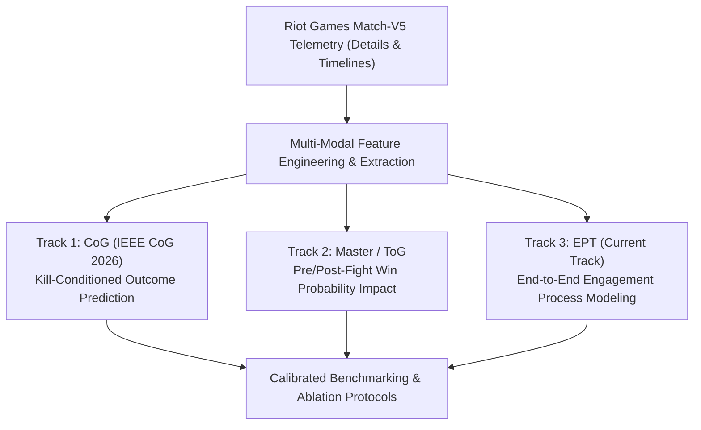

# LOL Teamfight Lab: Multi-Resolution Telemetry Analysis and Process Modeling for League of Legends

[](https://ieee-cog.org/)
[](pyproject.toml)
[](LICENSE)
[](c_ept/)

> **Language Navigation / 언어 바로가기**:  
> [English Overview](#english-overview) | [Research Tracks](#the-three-research-tracks) | [Repository Layout](#repository-layout) | [Getting Started](#getting-started) | [Citation](#citation) | [한국어 안내 (Korean Summary)](#korean-summary-한국어-안내)  
> *Detailed Korean documentation is also maintained in [README.ko.md](README.ko.md).*

---

## English Overview

**LOL Teamfight Lab** is a research monorepo investigating teamfights and multi-agent engagements in *League of Legends (LoL)* through large-scale public match and timeline telemetry.

The repository systematically tackles the complexity of MOBA engagements across three interconnected dimensions:
1. **Engagement Outcome**: Predicting casualty exchanges and teamfight winners from pre-fight conditions.
2. **Engagement Impact**: Quantifying shifts in match win probability before and after teamfights.
3. **Engagement Process (Current)**: Modeling the temporal lifecycle of engagements—from hazard buildup and initiation to tactical resolution and post-fight aftermath.

---

## The Three Research Tracks

The repository organizes historical and ongoing research into three dedicated tracks. While they share the common domain of LoL combat telemetry, each operates under tailored engagement definitions, temporal resolutions, and evaluation criteria:



### 1. EPT: Engagement-Process Modeling ([`c_ept/`](c_ept/))
- **Focus**: The **current active development track**. Models combat engagements as an end-to-end continuous process: engagement hazard generation &rarr; combat dynamics &rarr; post-engagement cascade.
- **Key Features**: Fine-grained temporal feature schemas, step-wise evaluation gates, and computational cost/latency profiling under strict budget constraints.
- **Entry point**: `lol-teamfight-ept`

### 2. CoG: Kill-Conditioned Engagement Outcome Prediction ([`COG/`](COG/))
- **Focus**: Companion codebase for our **IEEE Conference on Games (CoG) 2026** paper.
- **Approach**: Formulates teamfight prediction as a spatio-temporal classification task under minute-resolution telemetry. Fights are detected via spatiotemporally validated kill clustering (diameter splitting, alive-player radius filtering, candidate merging).
- **Architectures**: Evaluates 25+ architectures (LightGBM, BiLSTM, Transformer, EventXAttn, TCN, Mamba, GCN, GATv2, ST-GNN, EdgeSTGNN, ST-Mamba, and ensemble stacking) alongside 7 domain-knowledge ablations (T1–T7).
- **Entry point**: `lol-teamfight-cog` | [Read CoG Guide](COG/README.md)

### 3. Master / ToG: Win-Probability Impact Analysis ([`master_ver/`](master_ver/))
- **Focus**: Master thesis and follow-up expansion towards **IEEE Transactions on Games (ToG)**.
- **Approach**: Investigates the shift in calibrated win probability ($\Delta \text{WinProb}$) around teamfights, bounding what can be reliably inferred strictly prior to engagement initiation versus post-engagement resolution.
- **Entry point**: `lol-teamfight-master` | [Read Master Guide](master_ver/MODULARIZATION.md)

---

## Repository Layout

```text
LOL_teamfight_Lab/
├── c_ept/                  # EPT: Engagement-process modeling (Current development track)
├── COG/                    # CoG 2026: Kill-conditioned outcome prediction (Paper track)
├── master_ver/             # Master/ToG: Win-probability dynamics and pre-fight predictability
├── research_pipeline/      # Shared pipeline components for data processing and caching
├── common_training_r1/     # Shared training harnesses, metric calculators, and utilities
├── tools/                  # Verification tools and project launchers
│   ├── project_runtime/    # Lightweight multi-project environment & launcher library
│   └── check_project_boundaries.py # Structural boundary verification script
├── configs/                # Experiment configurations (e.g., s4a.example.json)
├── environment/            # Environment lockfiles and runtime specifications
├── docs/                   # Architectural standards, guidelines, and audit records
└── tests/                  # Unit and integration test suites
```

---

## Getting Started

### Prerequisites
- Python 3.8+ (Python 3.10+ recommended for EPT)
- Match data collected via the Riot API (Match-V5 Details and Timelines)
- *Note*: Raw match data and trained weights are excluded to comply with Riot API Terms of Service. Datasets are reconstructed deterministically via the local ingestion pipeline.

### Environment Setup

The repository utilizes modular Python environments to avoid dependency conflicts across research tracks:

#### Option A: Current EPT Environment
```bash
# In your dedicated EPT Python environment:
python -m pip install --no-index --no-deps --no-build-isolation -e .
lol-teamfight-ept --help
```

#### Option B: CoG and Master/ToG Launcher Environment
```bash
# In your launcher environment:
python -m pip install --no-index --no-deps --no-build-isolation \
  -e tools/project_runtime \
  -e COG \
  -e master_ver

# Access track-specific CLIs:
lol-teamfight-cog --help
lol-teamfight-master --help
```

### Boundary & Structure Verification
Verify that project and module boundaries remain intact without running heavy training workloads:

```bash
python -B tools/check_project_boundaries.py
```

---

## Citation

If you build upon or reference this research in your work, please cite our IEEE CoG 2026 publication:

```bibtex
@inproceedings{baek2026killconditioned,
  author    = {Baek, Seongeun and Kwon, Joonho},
  title     = {Kill-Conditioned Engagement Outcome Prediction in League of
               Legends Under Minute-Resolution Public Telemetry},
  booktitle = {IEEE Conference on Games (CoG)},
  year      = {2026}
}
```

---

## Further Reading & Documentation

- [Working Guidelines (`docs/WORKING_GUIDELINES_KO.md`)](docs/WORKING_GUIDELINES_KO.md): Core engineering and research rules.
- [Modularization Guide (`docs/MODULARIZATION_KO.md`)](docs/MODULARIZATION_KO.md): Monorepo structure and import boundaries.
- [Publication & Reproducibility Notes (`docs/PUBLICATION_20261024.md`)](docs/PUBLICATION_20261024.md): Data requirements and audit records.
- [Module Map (`MODULES.md`)](MODULES.md): Detailed map of source files and responsibilities.

---

<br>

---

## Korean Summary (한국어 안내)

### 프로젝트 소개
**LOL Teamfight Lab**은 라이엇 게임즈(Riot Games)의 공개 경기 및 타임라인 텔레메트리 데이터를 바탕으로, 리그 오브 레전드(League of Legends)의 한타 및 국지적 교전 메커니즘을 종합적으로 분석·모델링하는 연구 모노레포입니다.

본 저장소는 세 가지 상호 보완적인 연구 트랙을 한데 모아 관리합니다:

1. **EPT (`c_ept/`) — 교전 과정 모델링 (현재 주 개발 트랙)**:
   - 교전의 발생 확률(Hazard), 교전의 전개 및 결과, 교전 이후의 스노우볼링 효과까지 전 과정을 엔드투엔드로 모델링합니다.
   - 계산 비용 및 메모리 상한 제약(A6/A10 최적화)을 고려한 다목적 파레토 최적화를 수행합니다.
2. **CoG (`COG/`) — 킬 조건부 교전 결과 예측 (IEEE CoG 2026 채택 논문)**:
   - 1분 단위 타임라인 텔레메트리에서 시공간적으로 검증된 킬 클러스터 알고리즘으로 약 100만 건의 교전을 자동 추출했습니다.
   - LightGBM 정형 기준선부터 25개 이상의 최신 딥러닝/그래프 시공간 신경망(ST-GNN, Mamba 등)과 7대 도메인 지식 처리 기법을 비교 검증했습니다.
3. **Master / ToG (`master_ver/`) — 승률 변동 및 예측 한계 분석**:
   - 교전 발생 전후의 승리 확률 변화량($\Delta \text{WinProb}$)을 측정하고, 교전 발생 직전까지 관측 가능한 정보로 어디까지 예측 가능한지 인과적 한계를 규명했습니다.

### 시작하기 및 실행
```bash
# EPT 실행 CLI 도움말 확인
lol-teamfight-ept --help

# CoG 및 Master 실행 CLI 도움말 확인
lol-teamfight-cog --help
lol-teamfight-master --help

# 프로젝트 경계 및 구조 무결성 검사
python -B tools/check_project_boundaries.py
```

---

## License & Disclaimer

- **License**: MIT License. See [LICENSE](LICENSE) for details.
- **Disclaimer**: *LOL Teamfight Lab* is a research project and is not affiliated with, endorsed, or sponsored by Riot Games, Inc. League of Legends and Riot Games are trademarks or registered trademarks of Riot Games, Inc.
