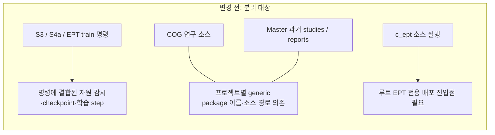
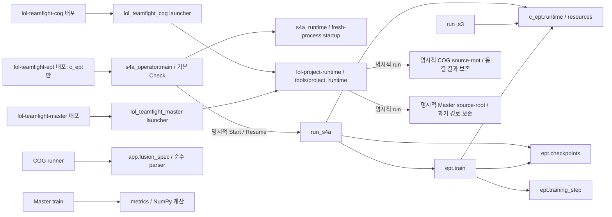

# 프로젝트 모듈화와 검증

2026-10-24 추가 코드 배치는 [모듈별 코드 지도](../MODULES.md)와 각 프로젝트의 MODULES.md에 정리한다. EPT의 데이터·특징·연구 계산과 CoG의 경계 분석, Master의 보고 코드는 역할별 하위 패키지에 구현을 두고 이전 경로를 호환 진입점으로 유지한다. 기존 연구 결과 및 실행 해시의 재검증을 대신하지 않는다.

## 구현 전 계획 (2026-10-24)

1. 루트 배포 이름과 console script를 EPT 전용으로 정하고 setuptools finder를 `c_ept` 및 그 하위 패키지로 제한한다.
2. 기존 `c_ept.s4a_operator:main`을 직접 연결한다. 기본 Check, help 조기 종료, 새 프로세스 native startup 계약을 유지한다.
3. 명시적으로 열거한 공유 컴포넌트의 AST import와 packaging TOML만 검사한다. cohort_policy/holdout 본문은 열거나 스캔하지 않는다.
4. stdlib/mocked 단위 검증으로 패키징 경계와 무학습 기본 동작을 확인한다. 실제 학습, GPU 점검, 대형 테스트는 실행하지 않는다.
5. COG/Master launcher와 공용 runtime의 배포·import 경계를 확인한다. 기존 연구 경로와 결과를 보존한다.

패키징·문서·검사 변경은 루트 pyproject.toml, 이 문서, 경계 검사 도구와 테스트, README에 둔다. 데이터·원고·동결 결과·학습 정의는 보존한다. 승인된 주석 검토·교체는 변경된 컴포넌트부터 구현과 대조하고 다른 위치의 낡은 설명도 검토한다. 기존의 올바른 수식을 보존하며, 전체 검토·교체를 마치기 전에는 모든 주석을 교체했다고 보고하지 않는다.

## 프로젝트와 설치 경계

| 프로젝트 | 배포 이름 / console command | 설치 대상과 역할 |
|---|---|---|
| 현재 EPT | `lol-teamfight-ept` | 루트 `c_ept`와 하위 패키지만. `c_ept.tests` 제외. 기존 `c_ept.s4a_operator:main` 직접 연결 |
| COG | `lol-teamfight-cog` | `COG/src/lol_teamfight_cog` launcher만. 동결 결과와 기존 연구 코드는 원래 소스 경로에 보존 |
| Master | `lol-teamfight-master` | `master_ver/src/lol_teamfight_master` launcher만. 과거 studies/reports 경로와 원고는 보존 |
| 공용 launcher runtime | `lol-project-runtime` (console command 없음) | `tools/project_runtime/src/lol_project_runtime`만. COG/Master가 `==0.1.0`으로 의존 |

루트 finder는 `include = ["c_ept", "c_ept.*"]`, `namespaces = false`, `py-modules = []`를 사용한다. COG/Master의 generic `train`, `core`, `config`, `scripts` 등을 루트 배포에 포함하지 않는다. COG/Master와 공용 runtime은 각각 `src` 아래 고유 패키지만 배포한다. `COG/app/fusion_spec.py`와 Master `studies/v_production_20261004/metrics.py`는 연구 소스에서 재사용하는 순수 helper이며 launcher wheel에 포함하지 않는다.

## 변경 전후 구조도

변경 전은 분리 대상과 설치 문제를 요약한 개념도다. 과거 전체 코드의 모든 호출 관계를 복원한 감사 결과는 아니다. 변경 후 실선은 현재 확인한 진입점과 주요 직접 의존 방향이며, 생략한 의존성도 있다.





재사용 컴포넌트에서 command 모듈로 향하는 역의존은 경계 검사가 거부한다. 위 소스 실행 화살표는 사용자가 명시적으로 실행을 선택한 경로를 뜻하며, help/Check가 학습을 실행한다는 뜻이 아니다.

COG/Master의 CLI는 프로젝트 표식과 entrypoint 목록만 선언한다. 공용 `lol_project_runtime.cli`는 인자 해석을, `.launcher`는 소스 루트 검증·명령 구성·자식 프로세스 실행을 맡는다. runtime은 연구 모듈을 import하지 않고 명시적으로 선택한 소스 파일을 별도 프로세스로 실행한다. EPT의 native startup/runtime과 이 launcher runtime은 역할과 배포가 서로 다르다.

전체 코드 검토와 낡은 주석 검토·교체는 승인된 작업 범위에 남아 있다. 아래 제한 점검은 그 전체 작업을 완료했다는 의미가 아니다. 성능·메모리·학습 결과의 전후 비교 측정은 수행하지 않았으며, 구조 분리나 단위 테스트 통과만으로 개선 수치나 결과 동일성을 주장하지 않는다.

## 격리 환경 설치 (PowerShell)

아래 명령은 저장소 루트에서 실행할 새 격리 환경 설치 안내다. 별도로 준비한 Python으로 환경을 만들고 각 환경의 절대/명시 경로를 사용한다. 실행 중인 Anaconda의 `python -m pip install` 또는 단순 `pip install`로 해당 환경을 변경하지 않는다.

실제 오프라인 editable 설치는 scratch venv에서 확인했다. [패키징 검증 보고서](superpowers/reports/2026-10-24-packaging-validation.md)에 따르면 최초 runtime/COG/Master 세 배포 smoke는 22/22 명령, 별도 EPT 추가 검사는 4/4 명령이 기대 종료 코드와 일치했다. 최초 합성 단위 시험은 38 passed / 4 skipped다. EPT를 최초 22개 명령이나 이 합성 시험 수에 포함하지 않는다. 설치 metadata의 venv 위치와 EPT의 원래 worktree 소스 매핑도 확인했다.

검증 venv는 `--system-site-packages --without-pip`로 만들어 기존 pip/build 도구를 상속한 환경이며 완전한 hermetic 격리는 아니다. `--no-index --no-deps --no-build-isolation`으로 로컬 editable 설치했고 Anaconda에는 설치하지 않았다. unrelated scratch cwd와 제거된 PYTHONPATH에서 launcher를 점검했으며 metadata/module 조회에는 `python -I -B`를 사용했다. 아래 신규 환경 설치 예시와 검증에 사용한 오프라인 도구 상속 방식은 구분한다.

```powershell
# EPT: entrypoint 설치 및 도움말만 확인
py -3.13 -m venv .venv-ept
& .\.venv-ept\Scripts\python.exe -m pip install --no-deps -e .
& .\.venv-ept\Scripts\lol-teamfight-ept.exe --help

# COG: 별도 환경에 launcher만 설치
py -3.13 -m venv .venv-cog
& .\.venv-cog\Scripts\python.exe -m pip install --no-deps -e .\tools\project_runtime
& .\.venv-cog\Scripts\python.exe -m pip install --no-deps -e .\COG
& .\.venv-cog\Scripts\lol-teamfight-cog.exe --help

# Master: 별도 환경에 launcher만 설치
py -3.13 -m venv .venv-master
& .\.venv-master\Scripts\python.exe -m pip install --no-deps -e .\tools\project_runtime
& .\.venv-master\Scripts\python.exe -m pip install --no-deps -e .\master_ver
& .\.venv-master\Scripts\lol-teamfight-master.exe --help
```

`--no-deps`는 과학 계산 패키지를 자동 설치하지 않는다. 빌드 도구 설치는 pip의 build isolation에서 일어날 수 있다. 네트워크가 없는 환경은 setuptools/wheel을 사전에 별도 환경에 준비해야 한다. 세 launcher의 설치 성공은 연구 코드의 실행 환경이나 수치 재현을 검증한 것이 아니다.

COG/Master는 명시적인 절대 `--source-root`를 요구하는 `list`, `check`, `run` 명령을 제공한다. 기본 호출은 도움말이다. `check`는 소스 표식과 entrypoint 파일의 가용성을 확인하며 연구 본문을 실행하지 않는다. 실제 실행은 `run`과 명시적인 전달 인자가 있어야 한다. Master의 일부 reference entrypoint는 배포 사본에 없을 수 있으며 임의 경로로 대체하지 않는다. 기존 절대 경로, 데이터, 환경 의존성을 launcher 설치만으로 해결하지 않는다.

## EPT 운영 계약

패키징의 Python 하한은 3.11이지만 실제 operator는 `environment/s4a-runtime.json`의 정확한 Python/패키지 버전을 검사한다. 현재 기록은 Python 3.13.5이다. `py -3.13`만으로 patch 버전이나 native 라이브러리 일치가 보장되지는 않는다. 실행용 환경은 해당 명세에 맞추어 따로 준비해야 하며 이 작업은 자동 업그레이드·다운그레이드를 수행하지 않는다.

지원 형태는 소스 checkout에 대한 editable 설치다. operator의 `ROOT = Path(__file__).resolve().parents[1]`은 다음 파일과 소스 Git 상태를 사용한다.

- 기본 설정: `configs/s4a.local.json` (`configs/s4a.example.json` 참고)
- 환경 명세: `environment/s4a-runtime.json`
- 실제 입력: 설정의 `s1`, `s2`, `s3` 절대 경로와 기존 run/catalog 경로
- 인터프리터: 설정 `python`은 새 격리 환경의 실행 인터프리터와 같아야 함

예제 설정에 남은 Anaconda 경로를 그대로 사용하지 않는다. 자신의 승인된 로컬 설정에 격리 환경 인터프리터 경로를 지정한다. `--config`는 설정 위치를 바꾸지만 `ROOT`나 환경 명세 위치를 바꾸지 않는다. wheel은 루트 `configs/`·`environment/`·Git checkout을 포함하지 않으므로 독립 wheel만으로 운영할 수 있다고 주장하지 않는다.

`lol-teamfight-ept --help`와 `python -m c_ept.s4a_operator --help`는 같은 API를 사용한다. 별도 wrapper나 eager native import를 추가하지 않았다. 새 CLI 프로세스에서 operator가 native import 전에 `prepare_native_runtime()`을 실행하는 순서를 유지한다. 이미 NumPy/Torch 등을 가져온 notebook/embedded 세션은 지원 운영 경로가 아니다.

인자 없는 기본 action은 `Check`다. 읽기 전용 preflight는 설정, 환경 버전, 검토된 깨끗한 Git 상태, E6 정책 등을 확인하며 NVIDIA 메타데이터 질의를 할 수 있다. Check는 학습이나 자동 설치를 수행하지 않으며 실패는 refusal로 반환한다. `Status`는 기존 상태 조회다. `Start`/`Resume`만 runner를 지연 import한다. 이번 작업에서는 실제 Check/GPU 조회/학습을 실행하지 않았다.

## 경계 검사와 검증 범위

```powershell
python -B tools/check_project_boundaries.py
python -B -m unittest discover -s tests -p test_project_boundaries.py -v
```

도구는 pyproject TOML 4개와 다음 19개 allowlist 파일만 연다. 경로 glob, 저장소 전체 raw scan, runtime import를 사용하지 않는다.

- `c_ept/s4a_runtime.py`
- `c_ept/runtime/__init__.py`, `c_ept/runtime/resources.py`
- `c_ept/ept/checkpoints.py`, `c_ept/ept/training_step.py`
- `c_ept/ept/heads.py`, `c_ept/ept/compose_heads.py`
- `c_ept/compose.py`
- `COG/app/fusion_spec.py`
- `master_ver/studies/v_production_20261004/metrics.py`
- `COG/src/lol_teamfight_cog/{__init__,__main__,cli}.py` (명시한 3개 파일)
- `master_ver/src/lol_teamfight_master/{__init__,__main__,cli}.py` (명시한 3개 파일)
- `tools/project_runtime/src/lol_project_runtime/{__init__,cli,launcher}.py` (명시한 3개 파일)

AST에서 중첩 함수 안의 import, 상대 import, 문자열 상수 `import_module`/`__import__` 호출을 확인한다. 공유 코드에서 `run_s*`, `train`, `s4a_operator` command 모듈 의존을 거부한다. launcher는 표준 라이브러리·자신의 고유 패키지·공용 runtime만, fusion parser는 표준 라이브러리만, Master metrics는 표준 라이브러리와 NumPy만 허용한다. 배포 검사는 이름·entrypoint·finder와 의존성을 확인하며 두 launcher의 runtime pin과 runtime 버전의 일치를 검사한다. import 대상의 본문을 따라가지 않으므로 protected `cohort_policy`/holdout 본문을 읽거나 스캔하지 않는다. 계산된 동적 import, alias를 통한 호출, 전이 의존성 전체는 이 제한된 검사의 증명 범위 밖이다.

단위 테스트는 잘못된 finder/의존성 선언과 command·과학 코드 import 거부, 파일 읽기 allowlist, 새 프로세스의 EPT console target help와 native 모듈 미적재, mock 환경에서 기본 Check 성공/거부 시 runner 미호출을 확인한다. COG/Master의 기본 호출과 help도 공용 runtime을 통해 소스·과학 모듈 import 없이 종료하는지 subprocess 실행 차단 상태에서 확인한다. 학습/GPU 테스트, 전체 프로젝트 테스트, 설치/build smoke, 수치 재현 검증은 포함하지 않는다. 패키지 finder의 별도 직접 확인에서는 `c_ept`, `c_ept.checks`, `c_ept.ept`, `c_ept.runtime`만 발견됐다.

경계 단위 검증은 모듈 경계와 진입점의 제한된 계약에 관한 것이며 동결 결과·연구 해석·통계적 타당성의 재검증은 아니다. 별도의 editable 설치/build 증거는 위 패키징 보고서에 기록돼 있으며 경계 검사 결과와 구분한다. 일반 배포 wheel이나 과학 실행의 검증으로 확대하지 않는다. commit/push는 수행하지 않았다.

### 실행 결과 (2026-10-24)

최종 상태: 아래 경계 단위 검증과 별도 오프라인 editable 설치 검증은 통과했다. 설치 증거의 원천은 [패키징 검증 보고서](superpowers/reports/2026-10-24-packaging-validation.md)이며, 일반 wheel·과학 실행·수치 재현 검증으로 확대하지 않는다.

- `python -B tools/check_project_boundaries.py`: 통과. pyproject 4개와 allowlist AST 파일 19개 확인.
- `python -B -m unittest discover -s tests -p test_project_boundaries.py -v`: 11개 통과.
- 별도 패키징 보고서: runtime/COG/Master 오프라인 editable smoke 22/22 명령, 합성 시험 38 passed / 4 skipped. 실제 symlink 생성 권한 부족으로 2개, COG에 없는 Master 전용 reference 조건으로 2개 skip했으며 mocked 루트 이탈 거부 시험은 양쪽 모두 통과했다.
- EPT 별도 설치 검증 4/4 명령: editable 설치, metadata/source mapping, 설치된 console help, module help. console help에서 native/scientific 모듈 import는 관측되지 않았다. 기본 Check/native 준비 단계에는 진입하지 않았다.
- 경계 단위 테스트의 Check는 mock 기반이다. 패키징 smoke의 COG/Master `check`는 파일 가용성/경로 검사다. 실제 EPT 무인자 Check 및 Check/Start/Resume/Status, GPU 연산, 과학 runner, 학습, 대형 테스트, 일반 배포 wheel, 수치 재현 검증은 수행하지 않았다. Anaconda에는 설치하지 않았다.

## 제한된 주석·참조 점검과 해결 결과

최초 점검의 네 후보는 Gemini 교체와 Codex 검토를 거쳐 docstring 다섯 곳에 반영됐다. 현재 설명의 적용을 다시 확인했다. train/heads의 기존 수식은 검토 결과 원문 그대로 보존됐고, 모듈 소유권과 미동봉 참조에 관한 설명만 좁게 추가됐다. 이 해결 기록은 제한 점검의 범위와 감사 한계를 바꾸지 않는다.

2026-10-24의 점검 대상은 위 19개 파일, `c_ept/ept/train.py`, `c_ept/run_s3.py`, `c_ept/run_s4a.py`, `c_ept/heads.py`, `COG/runner.py`, Master `studies/v_production_20261004/train.py`, `c_ept/ept/__init__.py`의 26개 파일이다. 주석·docstring의 단계/Task/학습/checkpoint/sampler/모듈 참조를 추리고 해당 설명과 가까운 코드 및 참조 경로의 존재를 확인했다. protected 파일은 열지 않았고 import 대상 본문으로 확장하지 않았다. 이는 전체 코드 감사나 모든 주석의 정확성 판정이 아니다. 아래 줄 번호는 점검 당시 기준이다.

| 적용 위치 | 상태 | 반영한 사실 |
|---|---|---|
| `c_ept/ept/__init__.py:1` 모듈 docstring | 해결 | “in later tasks” 예고를 현재 data/encoder/heads/loss/scales/train/checkpoints/training_step/runtime 책임 지도로 교체했다. |
| `c_ept/ept/train.py:1`, `c_ept/ept/heads.py:1`, `c_ept/ept/__init__.py:1` 모듈 docstring | 해결 | 역사적 design/plan/contract의 해당 경로가 checkout에 미동봉됐고 원문까지 검증한 것은 아님을 명시했다. equation-index의 존재와 수식 정확성 검증도 구별했다. train은 checkpoint IO·배치 계산·자원 측정의 위임 소유권을 설명하며, train/heads의 기존 수식은 원문을 유지했다. |
| `c_ept/run_s4a.py:1` 모듈 docstring | 해결 | Status는 `c_ept.s4a_operator`의 action이며 실행기 자체 CLI의 action이 아니라고 명시했다. |
| `COG/runner.py:437` 격리 실행 docstring | 해결 | 모델별 Python 인터프리터·전역 실행 상태 분리로 설명을 좁혔다. 물리 RAM/GPU 격리나 자원 상한을 보장하지 않는다고 명시하고 기존 물리 격리 오해를 낳는 보장/주소 공간 식을 제거했다. |

Master train은 metrics 함수를 새 모듈에서 import하고 기존 호출/공개 이름을 유지한다. 이 제한 점검에서는 추가로 확정한 낡은 주석 후보가 없었다. 새 checkpoint/training_step/runtime와 heads/compose의 기존 수식을 일괄 교체할 근거도 확정하지 않았다. 후보 없음이나 위 네 항목의 해결은 전체 정확성 보증이 아니다. 올바른 기존 수식과 연구 정의의 보존 원칙은 유지하며, 이 표는 승인된 더 넓은 주석 검토·교체 범위를 제한하거나 그 전체 작업의 완료를 주장하지 않는다.
